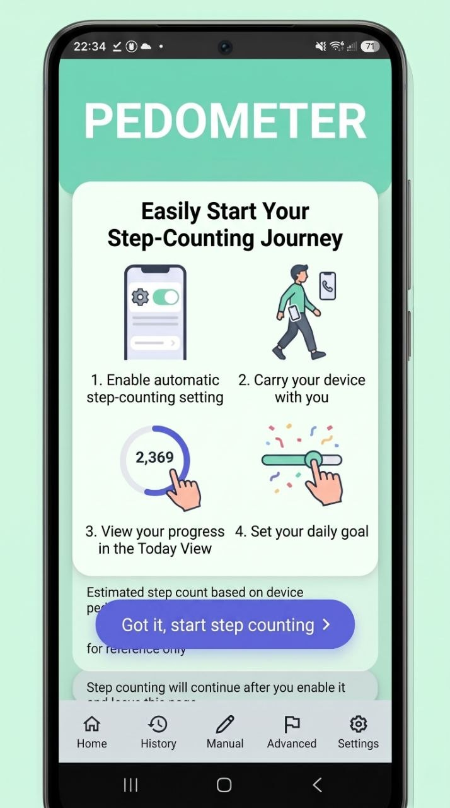
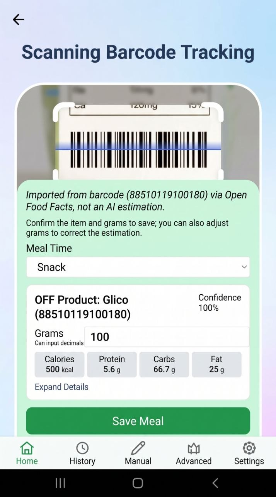
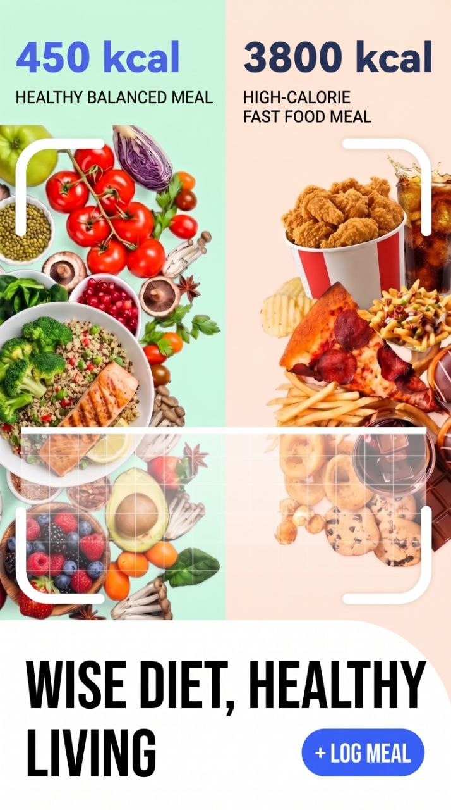
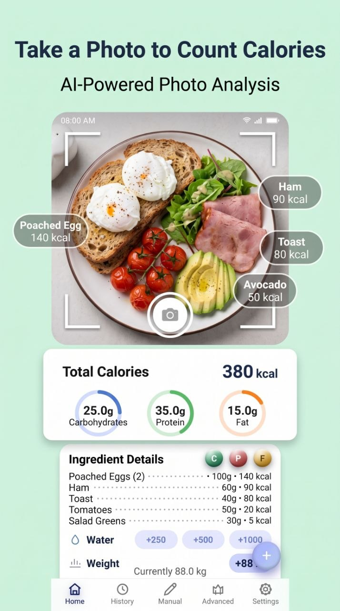

# Waimind — AI Photo Calorie Tracker

**Waimind** is a mobile-first AI calorie tracker for Android. Snap a photo of your meal and the app estimates calories, protein, carbs and fat in seconds — no manual searching, no food database browsing.

This page is the **official website of the Waimind mobile app**, published by the same team behind Healthy Western Recipes.

## What Waimind does

- **AI photo logging** — take a photo of a meal; the AI identifies the food and estimates calories and macros.
- **Barcode scanning** — scan packaged foods and import the nutrition facts automatically.
- **Manual entry** — log foods and nutrients directly, with quick-add for foods you eat often.
- **Daily nutrition targets** — calorie goal plus protein, carbs, fat, fiber, sugar and sodium.
- **Progress tracking** — weight chart (7 / 30 / 90 days), water intake, daily steps and activity burn (Health Connect supported).
- **AI weekly report** — a short review of your week with practical suggestions.
- **Offline-first** — your food log lives on your device; cloud backup is optional and off by default.
- **Privacy by design** — health data is never sold and never used for advertising targeting.

## Download Waimind

**[Get Waimind on Google Play →](https://play.google.com/store/apps/details?id=com.waimind.calorielogger)**

Package name: `com.waimind.calorielogger`

## Privacy and data

- **Privacy policy:** https://waimind01.github.io/waimind-legal/privacy
- **Terms of use:** https://waimind01.github.io/waimind-legal/terms
- **Data retention:** https://waimind01.github.io/waimind-legal/data-retention
- **Delete your account and data:** in-app (Settings → Data & Privacy) or the account deletion page

The free version shows banner ads served by Google AdMob. Premium removes ads. Health data (including Health Connect) is never sold, never used for advertising targeting.

## Screenshots & Demo

### App Screenshots

*Main screen — AI photo logging*

*Barcode scanning*

*Daily nutrition targets*

*Progress tracking*

*AI weekly report*

*Privacy settings*

### Demo Videos

<video controls width="100%" poster="/assets/waimind/img_07443f0164a8.jpg">
  <source src="/assets/waimind/video_02c702a3228c.mp4" type="video/mp4">
  Your browser does not support the video tag.
</video>
*Photo logging demo*

<video controls width="100%" poster="/assets/waimind/img_5a8eb766a452.jpg">
  <source src="/assets/waimind/video_82abdb4c7a6b.mp4" type="video/mp4">
  Your browser does not support the video tag.
</video>
*Barcode scanning & manual entry demo*

The free version shows banner ads served by Google AdMob.

## Contact

- **Support:** support@waimind.com
- **Publisher:** Waimind
- **App:** Waimind: AI Calorie Tracker (Android)

## About this website

`waimind.com` is operated by the Waimind team and publishes two things:

1. **Healthy Western Recipes** — our low-calorie Mediterranean recipe collection.
2. **This page** — information about the Waimind mobile app.

Both are run by the same independent team.