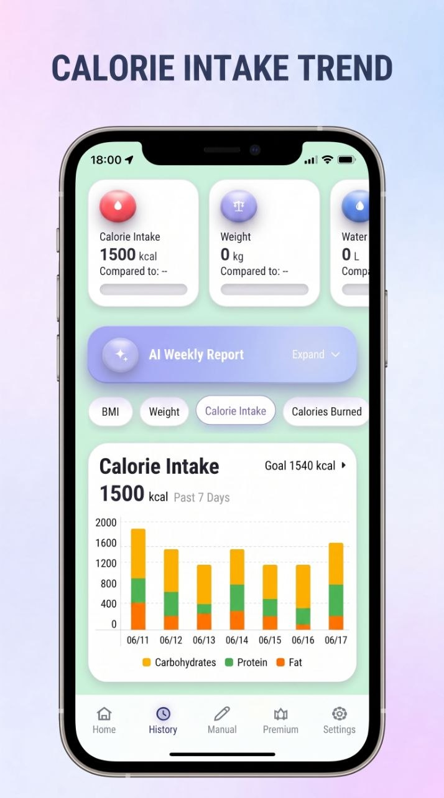
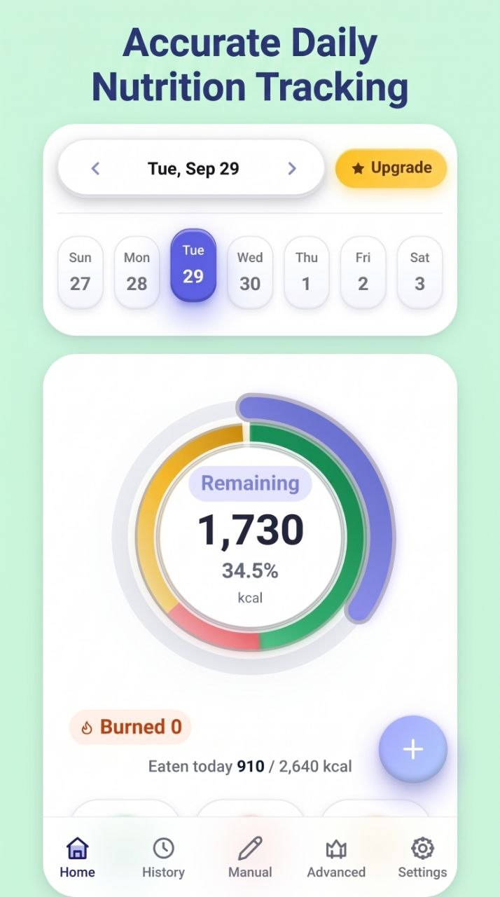

# Waimind — AI Photo Calorie Tracker

**Waimind** is a mobile-first AI calorie tracker for Android. Snap a photo of your meal and the app estimates calories, protein, carbs and fat in seconds — no manual searching, no food database browsing.

This page is the **official website of the Waimind mobile app**, published by the same team behind Healthy Western Recipes.

## What Waimind does

### 📸 AI Photo Logging
Take a photo of a meal; the AI identifies the food and estimates calories and macros instantly.

*Main screen — AI photo logging*

### 📊 Daily Nutrition Targets
Set calorie goal plus protein, carbs, fat, fiber, sugar and sodium targets. Track your progress visually.

*Daily nutrition targets*

### 📦 Barcode Scanning
Scan packaged foods and import the nutrition facts automatically.

*Barcode scanning*

### 📈 Progress Tracking
Weight chart (7 / 30 / 90 days), water intake, daily steps and activity burn (Health Connect supported).

*Progress tracking*

### 🤖 AI Weekly Report
A short review of your week with practical suggestions.

*AI weekly report*

### 🔒 Privacy by Design
Health data is never sold and never used for advertising targeting.

*Privacy settings*

## Demo Videos

### Photo Logging Demo
<video controls width="100%" max-width="600px" poster="/assets/waimind/img_07443f0164a8.jpg" preload="metadata">
  <source src="/assets/waimind/video_02c702a3228c.mp4" type="video/mp4">
  Your browser does not support the video tag.
</video>
*Photo logging demo*

### Barcode Scanning & Manual Entry Demo
<video controls width="100%" max-width="600px" poster="/assets/waimind/img_5a8eb766a452.jpg" preload="metadata">
  <source src="/assets/waimind/video_82abdb4c7a6b.mp4" type="video/mp4">
  Your browser does not support the video tag.
</video>
*Barcode scanning & manual entry demo*

## Download Waimind

**[Get Waimind on Google Play →](https://play.google.com/store/apps/details?id=com.waimind.calorielogger)**

Package name: `com.waimind.calorielogger`

## Privacy and data

- **Privacy policy:** https://waimind01.github.io/waimind-legal/privacy
- **Terms of use:** https://waimind01.github.io/waimind-legal/terms
- **Data retention:** https://waimind01.github.io/waimind-legal/data-retention
- **Delete your account and data:** in-app (Settings → Data & Privacy) or the account deletion page

The free version shows banner ads served by Google AdMob. Premium removes ads. Health data (including Health Connect) is never sold, never used for advertising targeting.

## Contact

- **Support:** support@waimind.com
- **Publisher:** Waimind
- **App:** Waimind: AI Calorie Tracker (Android)

## About this website

`waimind.com` is operated by the Waimind team and publishes two things:

1. **Healthy Western Recipes** — our low-calorie Mediterranean recipe collection.
2. **This page** — information about the Waimind mobile app.

Both are run by the same independent team.